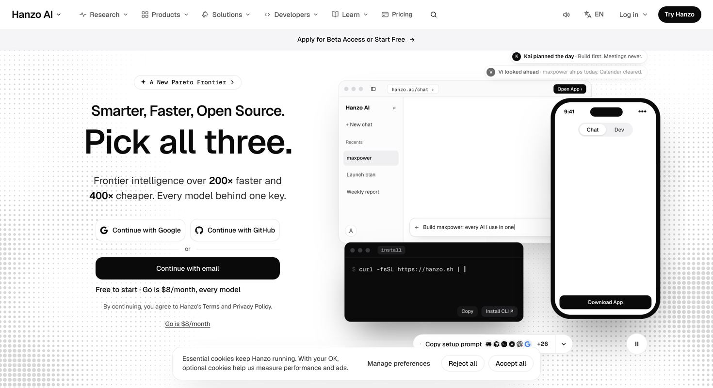
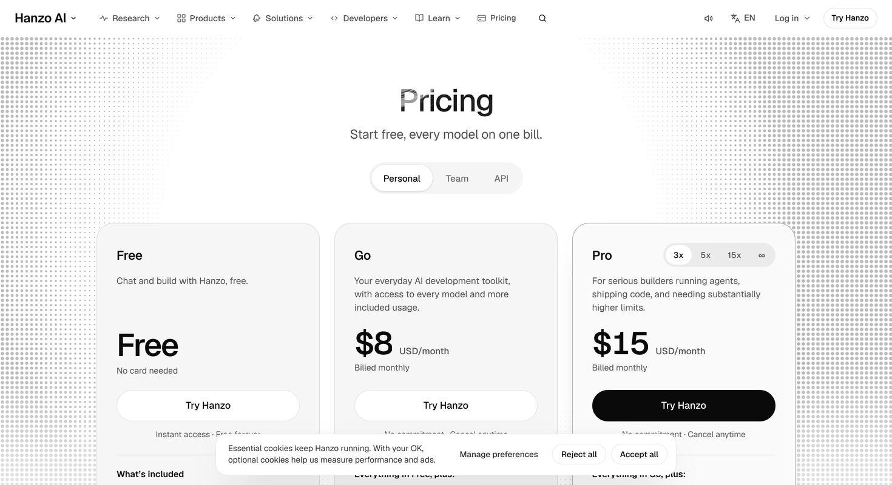
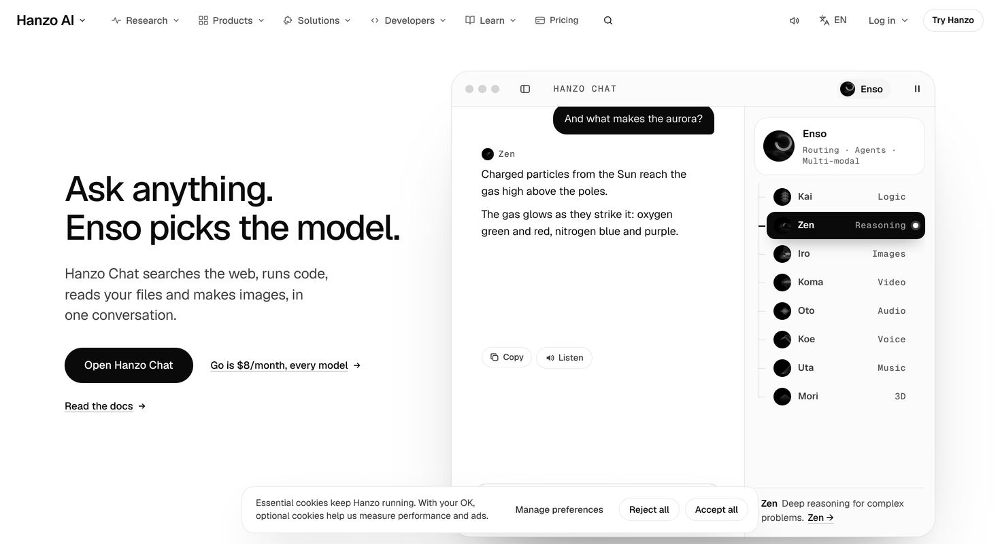
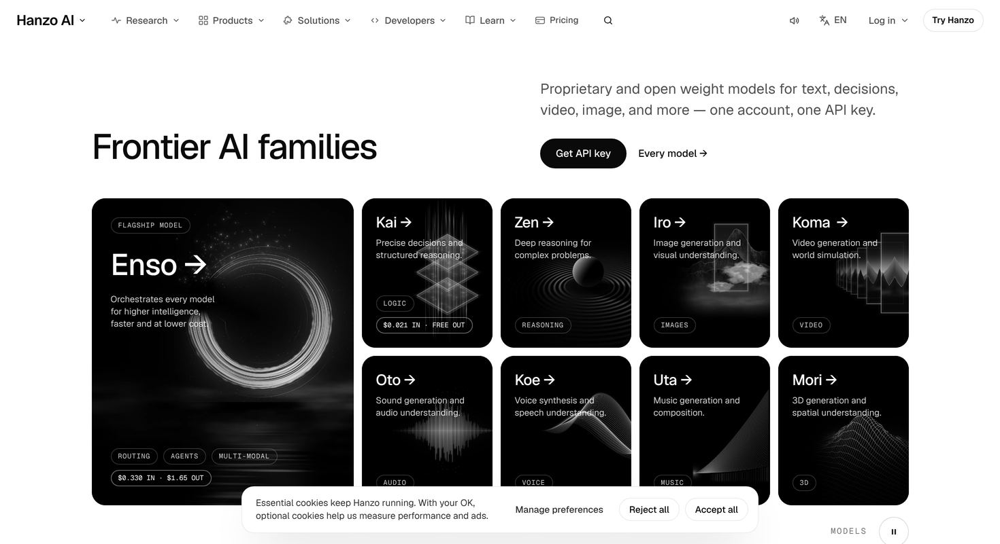
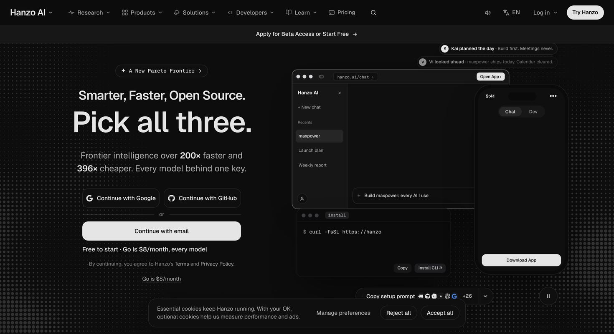
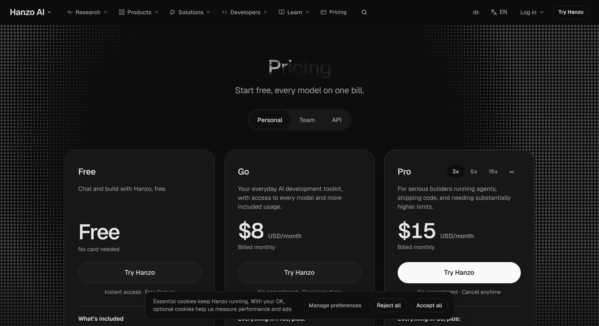
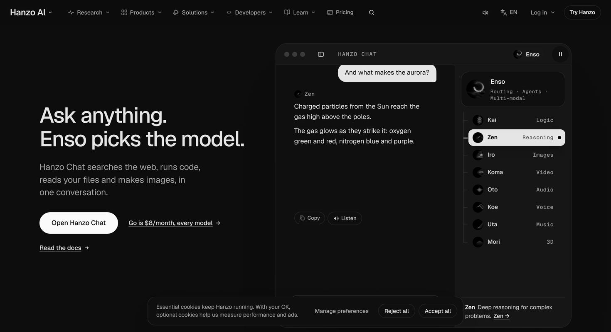
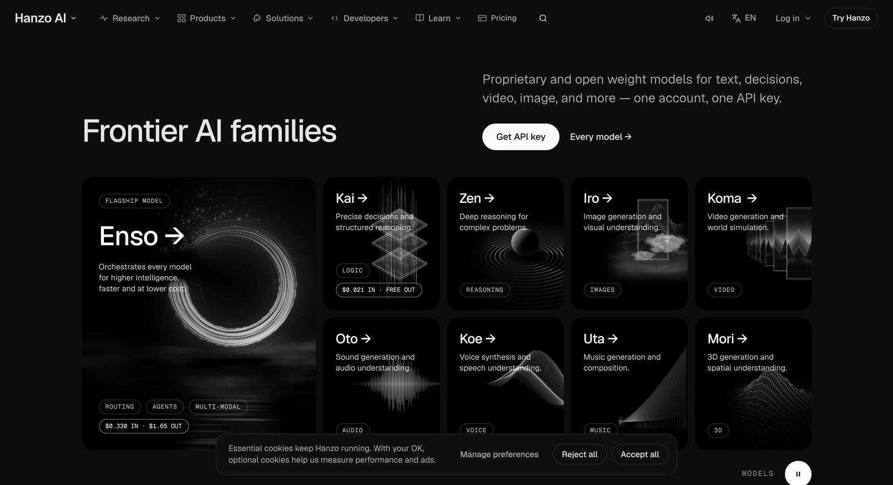

# hanzo.ai — the redesign

Every page of hanzo.ai, redesigned on Hanzo's own stack: **Next.js 16 (static export) · React 19 · Motion 12**, with
light and dark mode from Hanzo's own **`@hanzo/appearance`** and **`@hanzo/design`**.

- **897 pages**: every URL in hanzo.ai's sitemap, plus the home page, and **9 new sign-up and checkout pages**
  (`/pay`, `/signup`, `/login`…) that hand off to Hanzo's real checkout and hanzo.id ([details](#hand-offs-to-hanzos-real-flows)).
- **Hanzo's words, numbers and links, unchanged.** The redesign changes how pages look and move, not what they say.
  Copy was checked against live hanzo.ai: 148 of 152 checked pages match word for word; the other 4 differ only in
  Hanzo's rotating demo feeds ([details](#known-differences-from-live)).
- **Light and dark** follow the visitor's saved Hanzo choice, or their device setting. Dark mode was checked on 152
  pages: 0 unreadable spots.
- **A 2-minute video walkthrough**, with before/after against live hanzo.ai, is attached to the
  [v1.0 release](https://github.com/jamessburnss1313-dev/hanzo-site/releases).

| | Home | Pricing | Chat | Models |
|---|---|---|---|---|
| **Light** |  |  |  |  |
| **Dark** |  |  |  |  |

**Start here**

| You want to… | Go to |
|---|---|
| See what changed, page by page | [docs/RELEASE-NOTES.md](docs/RELEASE-NOTES.md) |
| Run or deploy it | [Run it](#run-it) · [Deploy](#deploy) |
| Change a price, plan or checkout link | [Prices, plans and checkout links](#prices-plans-and-checkout-links) (one file: `lib/plans.js`) |
| Understand light and dark | [Light and dark mode](#light-and-dark-mode) |
| Know where sign-in, checkout and the app live | [The app is hanzo.app](#the-app-is-hanzoapp) |
| Know where it differs from live | [Known differences from live](#known-differences-from-live) · [Before it goes live](#before-it-goes-live-on-hanzoai) |
| Know which branch to use | **`main`**, the only branch. Design history is archived: [docs/BRANCHES.md](docs/BRANCHES.md) |

## What changed vs live hanzo.ai

The redesign changes how hanzo.ai looks and moves, not what it says. It rebuilds all 897 site pages (every URL in
hanzo.ai's sitemap, plus the home page) and adds 9 sign-up and checkout pages. For the page-by-page list, see
[docs/RELEASE-NOTES.md](docs/RELEASE-NOTES.md).

### Home page (`/`)

- **The hero is live's own hero.** It has the same typing product demo (desktop app, phone, agent roster, "Copy setup
  prompt" bar) over a dotted field that swells under the pointer. The demo now has a pause button.
- **Every section reads in one frame.** At 1470×801, each section's title and content fit on one screen, with split
  headings and Hanzo's halftone lit from one corner (`components/home/wow.css`).
- **Models are a card grid, Enso to Mori.** The Enso feature card and eight model cards fit in one frame. Each film
  plays only while it is on screen. A click lifts the card's picture into the model's page (see Motion and feel).
- **Products are a scroll-driven 3D journey** (`components/home/journey/`). On wide screens the section is pinned, and
  scrolling moves a camera through the nine products in dock order. Each product is a graphite slab carrying its own
  screen. Drag to turn one, click to open it, or use the dock to jump to one.
- **Speed and cost share one dark room.** Agents, Race, Cheaper and Pareto use figures computed from api.hanzo.ai's
  research runs and price list. Each card has its own texture: speed lines, halftone, cost bands or hatch.
- **The rest of the page:** Backed by / Trusted by logo marquees, open source as a bento (tiles, commit calendar,
  repository cards), then pricing from `lib/plans.js`. Switching Personal, Team or API replays the plans' entrance.
- **An "On this page" index** sits on the right edge. It is written from the section headings and jumps to any section.
- **Arrival curtain.** On a first visit to the home page, Hanzo's mark assembles on black, then lifts within 700 ms
  (`components/arrival.js`). It is skipped for 7 days after that, on deep links, with Save-Data or 2G/3G, under reduced
  motion, and for bots.

### Every page

- **Each page has its own layout and one signature interaction.** `docs/MOTION-MAP.md` gives each of 150 designs
  (pages and page families) one of 28 signatures: live terminal, before/after slider, globe, race, words that light
  up, one question at a time, and others. No signature is used by more than 7 pages, or by two neighbouring pages.
- **Entrances differ too.** The map gives each page five section entrances from a library of 60 (iris, fold-out,
  card-deal, slot-roll…), with none repeated inside a page or carried over from the page before.
- **Hanzo's palette only.** Pages use Hanzo's black, white and greys. Colour comes only from Hanzo's model art, films
  and logos.
- **Zack's pages, rebuilt to the home page's standard.** Round 1: `/pricing`, `/beta`, `/beta/apply`, `/chat`, `/dev`,
  `/about`. Round 2: `/studio`, `/models`, `/benchmarks`, `/enso`, `/blog`. They share the home page's one-frame
  sections, split headings and lit halftone, with one dark room per page that opens like a curtain.
  (`components/pages/Frame.css` is CSS only.)
- **Round 2 pages are about half as tall** at 1470px wide: `/models` went from 13,649 to 6,693 px, `/benchmarks` from
  19,215 to 9,868 px, and `/blog` from 8,116 to 3,844 px (`docs/build-notes/zack-pages-2/README.md`).
- **`/chat`:** a chat window runs once. The question visibly routes through Enso to the model that answers, then a
  replay button appears. A hero prompt lands you in Hanzo Chat.
- **`/models`:** live's model grid is drawn as live draws it, with a light that follows the pointer. Below it, all 43
  models are in one priced list you can filter by family, price or search, with in/out $/M and "Use it now" on every
  row.
- **`/dev`, `/studio`, `/enso`, `/benchmarks`:**
  - `/dev`: a before/after file slider that sweeps when Dev lands its change.
  - `/studio`: a timeline whose playhead you can grab.
  - `/enso`: a switchboard that routes requests to Flash, Pro or Ultra.
  - `/benchmarks`: a live race at Hanzo's measured ratios, where you pick what races.
- **Company and contact pages:**
  - `/about`: the Pareto frontier draws itself.
  - `/careers`: roles are a deck of sheets.
  - `/platform`: an eleven-layer stack the camera travels down.
  - `/contact`: a patch panel.
  - `/contact-sales`: a one-question-at-a-time conversation whose draft survives a reload.
- **Page families each get one template:** `/models/*` (544 pages), `/cloud/*` (42), `/oss/*` (56), `/benchmarks/*`
  (27), `/integrations/*` (19), `/solutions/*` (18), `/blockchain/*` (16), `/legal/*` (11), `/careers/*` (8),
  `/products/*` (7), plus `/blog/*`, `/customers/*`, `/compare/*` and `/agents/*`.
- **Model pages each get a piece built from what the model does:** `/iro` resolves an image out of noise, `/koe` plays
  a waveform with its transcript, `/mori` settles a point cloud into a surface, `/oto` runs a live spectrogram.
- **404:** every wrong address draws its own contour map with a pin. It reads the address you tried, suggests the pages
  you most likely meant, and searches every page as you type. Live's 404 offers four links.

### Motion and feel

- **Motion 12** (`motion` 12.23.24) drives entrances, menus, sheets and shared-layout morphs. One site-wide policy,
  `MotionConfig reducedMotion="user"`, is set in `components/Chrome.jsx`.
- **Lenis smooth scrolling** (1.3.11). It loads after first paint and only for mouse and trackpad. Touch keeps native
  scrolling.
- **WebGL and 3D:**
  - three.js (0.186.1) drives the home products journey.
  - Model cards on home, `/models`, `/about`, `/chat` and `/studio` open as a WebGL plane that bends like pulled paper
    and lands on the next page's hero (`components/Opener.jsx`).
  - CSS 3D: the `/sdks` layers lift apart, and the `/blog` cover swings back.
- **Scroll-driven pieces:**
  - Home: the products journey.
  - `/open-source` and `/templates`: panels move sideways.
  - `/platform`: the camera travels down the stack.
  - `/slack`: the thread plays as you scroll.
  - `/careers`: each role rises over the last.
  - Zack's pages: the light and drift are CSS scroll-driven animations where the browser supports them.
- **Page transitions** (`components/Morph.jsx`). A large card grows into a full-screen stage that settles into the next
  page's hero in about 600 ms. A small link dims the page and fades the next one in. Back and Forward turn pages the
  same way, and Hanzo's header never moves.
- **Site-wide details:** a scroll progress bar, the footer's giant wordmark rising as a page ends, and a header that
  turns dark over dark sections.
- **Sound (new).** Six quiet Web Audio sounds at -24 dB (`lib/sound.js`, `components/Sound.jsx`). They mark a card
  opening, a main button, tabs and toggles, a successful Copy, ⌘K, and a demo finishing. They stay silent until the
  first click or key, never play on hover, scroll or page load, and have a mute toggle in the header that is
  remembered.
- **Reduced motion shows finished, still states:**
  - The marquee stands still.
  - The arrival curtain, card morphs and WebGL opener are skipped (links simply navigate).
  - The home journey falls back to the dock and stage.
  - `/dev` shows the finished race.
  - Reduced motion is read after mount, so the server HTML still matches (fixed in the shared `components/v2/`
    components and on many pages).
- **Anything that moves by itself can be stopped** (WCAG 2.2.2). The marquee rests under the pointer or focus, and
  self-running demos and films have pause buttons. Off-screen sections pause their animations (`[data-off]`).
- **Films play only while on screen** and while the tab is visible. Under reduced motion or Save-Data the poster stays
  (`Film` in `components/kit.jsx`).

### Light and dark mode

- **Hanzo's own system, as live runs it.** `@hanzo/appearance` 0.2.14's `bootScript` sits in `<head>`, and its output
  is byte-identical to the script in live's HTML. It replays the visitor's saved choice before first paint, or follows
  the device. As on live, there is no visible switch.
- **Choices stay in step across Hanzo sites and tabs.** `useAppearance()` applies the choice Hanzo IAM keeps.
- **Colours come from `@hanzo/design` 0.5.39.** Every dark colour is a reference to a Hanzo token (`var(--foreground)`,
  `var(--muted)`…), written as rules under `html:not(.light)`. Light values are kept separately, so changing one mode
  never moves the other.
- **The server HTML says `class="t_dark"`, as live's does,** so the page renders dark with JavaScript off, like live.
  The browser's theme colour follows the mode (#0A0A0A in dark, as live).
- **Canvases redraw when the theme flips.** For example, the home dot field, and the `/enso` particle ring, which was
  invisible in dark and now draws in `--foreground`.

### Navigation, menus, search, footer

- **Hanzo's own header, menus and footer** are on every page, with the same items and words (`lib/nav.js`). Their HTML
  is now rendered on the server (`components/Shell.jsx`).
- **Menus move.**
  - The panel drops from the header and morphs between menus, and the columns slide in the direction you moved.
  - On screens 1240px and wider, the right of each menu previews the link under the pointer.
  - The backdrop is live's (black 40%, blur 24px).
- **Menus work from the keyboard.** Enter, Space or ↓ opens a menu, the arrow keys move through its links, Tab past the
  last link moves on, and Esc closes the menu and returns focus.
- **⌘K / Ctrl+K search** covers every page and Hanzo's own groups. "Ask AI" answers in place, streamed from
  api.hanzo.ai `/v1/chat/public` (model `enso`, the request hanzo.ai/chat sends), with the current page as context. If
  the chat cannot be reached, it falls back to hanzo.ai/chat (`components/HeaderTools.jsx`).
- **The rest of the header works too:** the language menu with Hanzo's locales, the Log in choices (Log in now opens
  `/login`), and the cookie notice with its preferences.
- **The header carries each page's ask.** Once a hero's main button scrolls away, the header's solid button takes over
  that page's ask (for example "Open Hanzo Chat" on `/chat`), so only one solid button shows at a time
  (`components/Ask.jsx`).
- **Phones get their own controls:**
  - The Hanzo AI chevron opens a full-screen accordion sheet.
  - Search and the menus rise as bottom sheets that close when you drag them down.
  - A slim bar carries the page's ask only where it covers nothing.
  - A sideways swipe on a family page (a model, a role, a legal document, a repo) turns to the next one
    (`components/Phone.jsx`).

### Pricing and buying

- **`/pricing` shows every plan of the chosen tab side by side** (Personal, Team or API), each with its price, billing
  line, button and every feature. On a phone the plans stack.
- **Pro is marked Recommended** and has its usage switch on its own card: 3x, 5x, 15x or unlimited, at $15, $45, $95
  or $195. It never moves by itself.
- **The rest of `/pricing`:**
  - Each paid plan links to its own checkout, as on live.
  - "Compare plans" is a rising stair, with the full table under "Read more".
  - Enso's per-token rates sit in a dark room.
  - Team has a seat mixer.
- **Plan prices and checkout links live in one file, `lib/plans.js`.** Eleven pages read them: home, `/pricing`,
  `/bot`, `/buying-specialist`, `/dev`, `/chat`, `/enso`, `/benchmarks`, `/studio`, `/beta` and `/agents`. The values
  match api.hanzo.ai `/v1/billing/plans` as of 8 Nov 2026.
- **Every plan link resolves to a real plan.** `resolvePlan` accepts plan ids and plan names. A link with no plan, or an
  unknown one, shows a plan picker instead of a dead end. Redirects stay on this site (`safeNext`), and buyers return
  only to hanzo.ai hosts (`safeReturn`).
- **Interactive pricing on other pages:**
  - `/bot`: a "How many bots do you need?" slider lights the smallest plan that fits.
  - `/buying-specialist`: a quote sheet re-prices one seat at a time.
  - `/enso`: the three tiers and their prices are on the first screen.
- **A few buy buttons were added by design.** They use Hanzo's plan names and prices from `lib/plans.js`:
  - home: "Free to start · Go is $8/month, every model"
  - `/chat` and `/enso`: "Go is $8/month…"
  - `/dev`: "Get Hanzo Dev, $8/month"
  - `/benchmarks`: "Use every model here, Go is $8/month"
  - `/studio`: "See plans, from $8/month"
  - `/beta` and `/beta/apply`: "Skip the wait, go paid"
  - `/about`: "Try Hanzo" / "Book a call"

  Live does not show these, and each can be removed without affecting the rest of its page.

### Sign-in and checkout

- **They are hanzo.app's.** The redesign's mock sign-up and checkout pages were removed when the site moved to
  hanzoai/site: every sign-in, sign-up and pay link opens hanzo.app (see [The app is hanzo.app](#the-app-is-hanzoapp)).

### Live data

- **Each build reads live figures first.** `pnpm build` runs `scripts/live.mjs`, which refreshes
  `content/live/_*.json` from:
  - the commit calendar (`/v1/git/activity`);
  - research runs (`/v1/research/runs`);
  - model rates (`/v1/models`, `/v1/pricing/models`);
  - plan prices (`/v1/billing/plans`);
  - hanzo.ai's own open-source snapshot.
- **The build stops rather than ship stale figures.** If any source fails, `scripts/live.mjs` exits with an error.
  `HZ_LIVE_OFFLINE=1` builds from the saved snapshots on purpose.
- **Some pages read again in the visitor's browser:**
  - The home page re-reads the race, cost and frontier figures (`components/home/useFigures.js`) and keeps the build's
    snapshot if that fails.
  - The `/models` catalogue reads `/v1/models`.
  - `/machines` reads `/v1/pricing`.
  - `/bounty` and `/oss/*` read GitHub.
- **Forms post to api.hanzo.ai:** `/newsletter`, `/sms-opt-in`, `/startups` and `/grants`. `/contact-sales` sends
  exactly what hanzo.ai sends.

### Content fidelity

- **Hanzo's words, prices, plan names, checkout plan ids and links are unchanged.** They were captured from hanzo.ai on
  8 Nov 2026 (`content/pages/`, `content/live/`). If live changes, copy on live wins.
- **Copy check: 148 of the 152 pages checked match live word for word** (`scripts/copycheck.mjs`). The other four
  (`/slack`, `/tag`, `/team`, `/integrations/anthropic-sdk`) differ only in demo feeds and sample content that Hanzo
  rotates.
- **Search metadata is Hanzo's own:** each page's title, description, schema.org data (`content/jsonld/`) and heading
  outline (`content/outline/`).
- **One known number difference is kept on purpose.** hanzo.ai's daily commit figures add up to 835,124, while its label
  says 805,254. This site keeps Hanzo's label.
- **Not changed:** the `/chat` app and the dashboards stay in Hanzo's app.

### Accessibility

- **Skip link and focus.** "Skip to content" is the first tab stop. After every in-site navigation, focus moves to the
  new page's h1.
- **Overlays hold focus.** Search, cookie preferences and sheets keep Tab inside, close on Esc, and return focus.
  Detail sheets are native `<dialog>` elements.
- **Touch targets are 44px or larger.**
- **Pages are readable with JavaScript off.** A `<noscript>` rule clears entrance states, so every word shows.
- **Screen readers hear whole lines.** Where a line is split into animated pieces, it is also one text run, with the
  visual pieces `aria-hidden`.
- **Reduced motion and pause controls** are as described under Motion and feel.

### Performance and build

- **Stack:** Next.js 16.4.5, upgraded from 15.5.4 with the official codemod. Turbopack is the bundler, and Cache
  Components stay off. React 19.2.8 and Motion 12.23.24.
- **A static export:** `output: 'export'`, no trailing slash (hanzo.ai's own form). There is no server to run.
- **Less JavaScript on every page.** Hanzo's header and footer HTML render on the server, so the 375 KB `content.js` no
  longer ships in every page's JavaScript.
- **Heavy code loads only when needed:**
  - three.js loads only by dynamic import, in its own chunk, when the home products section comes near. It is never in
    the first load.
  - Lenis loads after first paint.
  - The frame layer on Zack's pages is CSS only.
  - Home figures are computed on the server (home first-load JS went from 287 to 280 kB).
- **Fonts paint once.** Zen and Zen Mono are preloaded with `font-display: block`, so there is no visible font swap.
- **SEO and sharing:**
  - Each page has its canonical link, Open Graph and X tags, and its own share-card image (`/og/<route>.png`, drawn at
    build with the page's own contour map).
  - `sitemap.xml` comes from `lib/routes.json`, without the app steps.
  - `robots.txt` and `icon.svg` are included.

### Assets

- **19 partner and customer logos** are in `public/logos/`:
  - 7 partners: Amazon, DigitalOcean, Google, Microsoft, Nebius, NVIDIA, Techstars.
  - 12 customers.
  - They show white in dark mode and black in light.
- **Product screens for the home journey** are in `public/home/products/`, one per product and mode, captured from the
  stage.
- **Hanzo's fonts** (Zen, Zen Mono, Zen Pixel, plus the Arabic faces) are in `public/fonts/`.
- **Some media is not in this repo:** Hanzo's model films, `/images/…` and `/memoji/…`. They stay at their hanzo.ai
  paths, and `public/` must be merged before launch.

### Quality checks run

- **Dark check** (`scripts/darkcheck.mjs`, which flags text under 3:1 contrast) listed 233 unreadable spots on 47 pages.
  Each was fixed with Hanzo's token for its role, and it now reports 0 of 152 pages, and 0 of 13 for the sign-up and
  checkout pages. Canvases and images were checked by eye.
- **Light check** (`scripts/lightcheck.mjs`): the dark-mode work did not move light mode. 795 pages ship byte-identical
  CSS, and the 103 pages whose CSS changed show 0 computed-colour differences at 1470px and 375px.
- **Copy and parity checks.** `scripts/copycheck.mjs` gave the 148 of 152 above. `scripts/parity.py` checks that every
  piece of text and every link on Hanzo's page is also on ours.
- **Design checks:**
  - `scripts/taste.py` flags colours outside Hanzo's palette.
  - `scripts/unique.py` fingerprints each page's section order, signature and first-screen layout, so no two pages
    match.
  - `scripts/motion_map.py` regenerates the motion map.
- **Light vs dark, same information** (8 Nov, before release): every page was read in both modes to confirm the same words, numbers and links show in each. The only differences were animations caught mid-step and dark bands that are dark on purpose.
- **Phones:** every page was laid out and checked at 375–390px wide.
- **Zack's round 2:** on the production build, the tallest section at 1470×801 is 774px. There are 0 console errors and
  0 sideways scroll at 1470px and 375px, in light and dark.
- **Unit tests** (`node --test`) and the light/dark screenshots in `docs/screenshots/`.

## Run it

Node 22.18 or newer, pnpm (corepack). Next.js is 16.4.5 (upgraded from 15.5.4 with the official codemod on 8 Nov; Turbopack is the default
bundler, Cache Components stays off because the site is a static export, React stays on 19.2.8).

```bash
pnpm install
```

```bash
pnpm dev           # http://localhost:4180, hot reload
```

```bash
pnpm build       # static export of every page into out/
```

```bash
pnpm preview   # serves out/ on http://localhost:4181
```

**`pnpm build` reads live figures first.** `prebuild` runs `scripts/live.mjs`. It refreshes `content/live/_*.json`
from api.hanzo.ai and hanzo.ai: commit calendar, research runs, model rates and plan prices. If any source fails, the
build stops rather than ship stale numbers. To build from the saved snapshots on purpose (offline, or in CI without
network), run:

```bash
HZ_LIVE_OFFLINE=1 pnpm build
```

In dev and preview, any file this repo lacks (Hanzo's own model
videos, `/images/…`, `/memoji/…`) is fetched from hanzo.ai, so pages look complete before `public/` is merged.

## Deploy

`pnpm build` writes the whole site as static files to `out/` (`output: 'export'` in `next.config.mjs`,
no trailing slash, so `/pricing` is `out/pricing.html`). Serve `out/` from any static host or CDN
(Cloudflare Pages, Vercel, Netlify, S3 + CloudFront, nginx). There is no server to run. Do the steps in
[Before it goes live](#before-it-goes-live-on-hanzoai) first: merge `public/` media and route the app paths.

## Folder map

```
app/                 one folder per route (app/pricing/page.jsx = /pricing). [slug] folders render a page family:
                     /models/*, /cloud/*, /blog/*, /customers/*, /compare/*, /benchmarks/*, /oss/*, /agents/*,
                     /solutions/*, /integrations/*, /legal/*, /careers/*, /blockchain/*, /products/*
app/layout.jsx       the shell for every page: <head>, the appearance boot script, Hanzo's header and footer
app/globals.css      site-wide tokens and base styles (light values, plus dark as references to Hanzo's tokens)
app/system.css       shared component styles
components/          the page code
  pages/             one file per page or page family (Pricing.jsx, ChatPage.jsx, ModelsPage.jsx, About.jsx…)
  home/              home page sections
  kit.jsx, ui.jsx    the shared building blocks every page uses (buttons, links, bands, tabs, sheets, motion helpers)
  v2/                shared motion components (odometer, line reveal, stages…)
  Chrome.jsx         Hanzo's header, menus and footer
  Appearance.jsx     light/dark (see below)
content/             Hanzo's content, as captured from hanzo.ai
  pages/             each page's captured HTML (pages.json: titles and descriptions)
  live/              what hanzo.ai shows today, per page (text and links), plus the _*.json figure snapshots
  jsonld/, outline/  each page's structured data and its heading outline
content.js           home data: header, footer, logos, product screens
lib/                 shared logic: plans.js (prices and checkout links), routes.json (every route), nav.js,
                     liveSources.mjs (the api.hanzo.ai sources), og/ (social images)
public/              fonts, logos, customer and author images, hanzo.css (Hanzo's own stylesheet)
scripts/             build and checking tools (see Scripts)
docs/                RELEASE-NOTES.md, BRANCHES.md, DARK-MODE.md, MOTION-MAP.md, screenshots/, and build-notes/
                     (the design process; not needed to run)
```

## The home page

`app/page.jsx` renders `components/pages/Home.jsx` (approved on 8 Nov). Every section reads in one frame
at 1470×801: its title and its content fit on one screen. Top to bottom:

| Section | Component | Notes |
|---|---|---|
| Hero, typing product demo | `components/Hero.jsx`, `home/Devices.jsx` | The scenes' data is in `home/hero-scenes.json`; the three devices are drawn as @hanzo/app, `hanzo dev` and hanzo.app on a phone draw themselves |
| Backed by / Trusted by | `Marquee` (`components/Chrome.jsx`) | Logos in `public/logos/` (white in dark, black in light) |
| Models: the card grid, Enso to Mori | `components/Models.jsx` | The Enso feature card and eight model cards in one frame (`home/wow.css`); each film plays while on screen, a click opens the model's page |
| Products: a 3D journey, App to Team | `components/home/Platform.jsx`, `home/journey/Journey.jsx`, `home/journey/scene.js` | Pinned; scrolling moves a camera through the nine products in dock order, each a faceted graphite slab carrying its own screen (`public/home/products/<name>-<theme>.webp`, captured from the stage); drag turns one, click opens it, the dock jumps to one. **three.js (0.186.1) loads only by dynamic import**, in its own chunk, when the section comes near; never in the first load. Phones, reduced motion and no WebGL get the dock and stage |
| Agents, Race, Cheaper, Pareto | `components/Agents.jsx`, `Race.jsx`, `Cheaper.jsx`, `Pareto.jsx` | Figures are worked out on the server (`home/snapshot.js`) and re-read live in the browser (`home/useFigures.js`) |
| Open source | `components/Open.jsx` | |
| Pricing | `components/home/Pricing.jsx` | Prices and links from `lib/plans.js` |

The one-frame layout, split headings and lit halftone are in `components/home/wow.css`.

## Light and dark mode

Hanzo's own system, exactly as live hanzo.ai runs it. Full detail: `docs/DARK-MODE.md`.

- **`@hanzo/appearance`** (0.2.14). `app/layout.jsx` puts `bootScript({ base: { theme: 'system' } })` in `<head>`.
  Before the first paint it replays the visitor's saved choice (`localStorage['hanzo.appearance.painted']`), else follows
  the device (`prefers-color-scheme`). It sets `light t_light` or `dark t_dark` on `<html>`.
- **`components/Appearance.jsx`** calls `useAppearance()` once at the root. It applies the choice Hanzo IAM keeps across
  Hanzo sites, follows the device while the theme is `system`, and syncs across tabs. There is no visible switch,
  as on live.
- **Colours come from `@hanzo/design`** (0.5.39, `tokens/colors.css`). Dark is the default (`:root`, `:not(.light)`),
  light is `.light`. Every dark colour in this repo is a reference to Hanzo's tokens (`var(--foreground)`,
  `var(--muted)`…), written as `html:not(.light) …` rules beside each page's CSS. Light values are separate, so
  changing one mode never moves the other.
- To test: DevTools › Rendering › `prefers-color-scheme`, or Playwright `newContext({ colorScheme: 'dark' })`.

## Prices, plans and checkout links

**Plan prices are Hanzo's billing API, never typed here.** `scripts/live.mjs` (prebuild) writes
`content/live/_pricing.json` from `GET api.hanzo.ai/v1/billing/plans`, and `lib/plans.js` reads it: Go, Pro, Dev,
Max and Ultra by the month (no personal plan has a year), Team and Team Premium per seat by the month or the year,
Enterprise per seat by the year, with each plan's minimum seats. A price is changed in admin.hanzo.ai and reaches the
next build. Every page that shows a plan reads `lib/plans.js`: home, /pricing, /bot, /buying-specialist, /dev, /chat,
/enso, /benchmarks, /studio, /beta and /agents. Checkout links (`checkout`, `teamCheckout`, `teamCart`) open
hanzo.app's card form and return there. `pnpm test` holds the two to each other.

These prices are **not** plan prices, so they stay where they are shown. Each one is Hanzo's copy:

| What | Where |
|---|---|
| Per-token model rates on /pricing (API tab), and the compute, tool and web-call rates | `components/pages/Pricing.jsx` lines 403 (`RATES`), 416 (`GROUPS`), 453 (`TOOLS`) |
| Volume & Dedicated ("from $5k/mo") | `components/pages/Pricing.jsx` line 134, `components/home/Pricing.jsx` line 124 |
| Model rates on /models and each model page | `components/pages/models/rates.js` line 6; `content/live/_models.json` (refreshed at build) |
| Home "cheaper" figures and Pareto plot | `components/home/figures.js`, from `content/live/_models.json` and `_research.json` |
| /bot FAQ lines that quote prices ($100/mo floor, $800/mo, $15/mo floor) | `components/pages/Bot.jsx` lines 711, 713, 831 |
| /enterprise offer ($999 a month) | `components/pages/Enterprise.jsx` line 634 |
| Product pages with their own plan tables: Captable, Dataroom, Sign, Crawl, DNS, Search | `const PLANS` in `components/pages/apps/Captable.jsx` 320, `apps/Dataroom.jsx` 370, `apps/Sign.jsx` 309, `cloud/Crawl.jsx` 330, `cloud/Dns.jsx` 339, `cloud/Search.jsx` 401 |
| Prices inside blog posts, press releases and benchmarks | each page's own data file; they are dated statements, not live prices |

Other plan links, as live has them. /pricing: Free goes to `/signup`, Enterprise to `/enterprise/start`, API to `/dev`
and `/contact-sales` (`components/pages/Pricing.jsx`, `planOf` and `cardOf`). Home pricing: Free and Team to `https://hanzo.ai/signup`, API to `https://platform.hanzo.ai`,
Enterprise and Volume to `/pricing` (`components/home/Pricing.jsx` lines 103–125).

## The app is hanzo.app

hanzo.ai is the signed-out site. Chat, sign-in, sign-up, checkout and every app room are
[hanzo-inc/app](https://hanzo.app) on hanzo.app. `lib/route.js` sends any path this site has no page for to
`https://hanzo.app` (`lib/app.js`), so `/login?next=%2Fchat` opens hanzo.app's sign-in and `checkout('go')` opens
hanzo.app's card form. This site never collects a card, a password or a code.

## Before it goes live on hanzo.ai

1. **Merge `public/` from the current site.** Model videos (`/models/*.webm`), `/images/models/*`, `/memoji/*` and other
   media are referenced at their existing hanzo.ai paths and are not in this repo.
2. **App routes are not in this repo:** `/chat` (the app) and dashboards. (`/pay/*`, `/signup`, `/login`, `/auth/callback` and `/onboarding` are designed here and hand off to Hanzo's real checkout and hanzo.id; see [Hand-offs](#hand-offs-to-hanzos-real-flows).) Links point at
   them as they are today. Serve them from the app with edge rewrites, or drop `output: 'export'` in `next.config.mjs` and
   add Next.js `rewrites()` to the app's origin.
3. **Build with network** (no `HZ_LIVE_OFFLINE`), so figures and plan prices are fresh from api.hanzo.ai.
4. **Browser reads.** The home page also re-reads model rates and research figures from api.hanzo.ai in the visitor's
   browser (`components/home/useFigures.js`), keeping the build's snapshot if that fails. api.hanzo.ai must allow
   hanzo.ai's origin (it does today).

## Scripts

| Script | What it does |
|---|---|
| `node scripts/copycheck.mjs /pricing /about …` | **Compare our copy with live hanzo.ai.** Opens live hanzo.ai and our dev server (`pnpm dev`, or `HZ_BASE=…`) in headless Chrome. Lists every line of live text missing from ours in `shots/copycheck/<page>.txt`. "missing 0" means every word is there. Needs Chrome (`CHROME=/path/to/chrome` on Linux). |
| `node scripts/live.mjs` | Refresh the figure snapshots in `content/live/_*.json` (runs before every build). `--pages /x /y` re-reads those pages' live text. |
| `pnpm capture` / `pnpm extract` | Re-capture pages from hanzo.ai into `content/`, and re-read the home's header, footer and logos. |
| `HZ_BASE=http://localhost:4180 node scripts/darkcheck.mjs` | Dark-mode readability: opens every page in `scripts/copycheck-pages.txt` in dark, and flags visible text under 3:1 contrast against its background. Done means 0 pages. `CHROME=/path/to/chrome` on Linux (run as root it also needs `--no-sandbox`). |
| `HZ_OLD=… node scripts/lightcheck.mjs /page` | Light mode unchanged: compares every element's computed colours with an older build. |
| `node --test scripts/*.test.mjs components/**/*.test.mjs` | Unit tests. Tests that open a browser need `CHROME=…`. |
| `python3 scripts/taste.py <files>` | Flags colours outside Hanzo's palette. |

The other scripts in `scripts/` were used during the design work: filming, motion maps, parity reports.

## Known differences from live

Wording and prices follow live hanzo.ai as captured on 8 Nov 2026 (`content/live/`, last figures snapshot
2026-11-08 03:50 UTC). Where this repo knowingly differs, it is listed here, and nothing was reworded to "fix" it:

- **Buy buttons added by design.** A few pages gained a direct way to buy, worded with Hanzo's own plan name and price
  (from `lib/plans.js`): home ("Free to start · Go is $8/month, every model"), /chat and /enso ("Go is $8/month…"),
  /dev ("Get Hanzo Dev, $8/month"), /benchmarks ("Use every model here, Go is $8/month"), /studio ("See plans, from
  $8/month"), /beta ("Skip the wait, go paid"), /about (a "Try Hanzo" / "Book a call" row). Live does not show these.
  Remove any you don't want; the rest of each page is unaffected.
- **Commit total on the home calendar.** hanzo.ai's daily figures sum to 835,124 while its label says 805,254. This
  site keeps Hanzo's label.
- **Dark mode was fixed spot by spot, the Hanzo way.** `scripts/darkcheck.mjs` listed 233 unreadable spots on 47 pages
  on 8 Nov (`docs/build-notes/dark-issues-8nov.json` has the earlier 259); each was fixed with Hanzo's token for its role,
  in rules under `html:not(.light)` (commits titled "dark tokens: ..."). It now reports 0 of 152 pages. Light mode is
  unchanged: 795 pages ship byte-identical CSS, and the 103 whose CSS changed show 0 computed-colour differences in
  `scripts/lightcheck.mjs` at 1470px and 375px. The checker reads text only, so canvases and images were checked by eye
  (the /enso particle ring was invisible in dark and now draws in `--foreground`). Pages outside
  `scripts/copycheck-pages.txt` were not run through the checker.
- **Copy checked against live on 8 Nov: 148 of 152 pages match word for word.** `scripts/copycheck.mjs` was run
  against live hanzo.ai on the final build (the pages in `scripts/copycheck-pages.txt`). The lines it lists on
  the other four pages are live demo feeds and sample content that Hanzo updates, so they rotate and are not chased:
  - **/slack** and **/tag** (3 lines each): the demo workspace's sample channel and items, "slack - karma style
    (karma.style) · #bug-button-darkmode", "tryon-3d-lookbook" and "karma/storefront".
  - **/team** (5 lines): the same demo feed, plus "#hanzo-rev · rev (revenue & billing ops)" and "verified org credit
    grants & billing lease lookup across 93 active sessions".
  - **/integrations/anthropic-sdk** (1 line): the sample key placeholder "your-hanzo-api-key".

  If live changes any other line later, run `node scripts/copycheck.mjs <page>` and restore it: copy on live always wins.
- **Sound.** Six quiet interface sounds that live does not have. Silent until the first click, never on hover or scroll, with a remembered mute toggle in the header (`lib/sound.js`, `components/Sound.jsx`).

## Docs

- `docs/RELEASE-NOTES.md`: what changed, page by page, in plain English.
- `docs/BRANCHES.md`: `main` is the only branch and the release; how to reach the archived design history.
- `docs/screenshots/`: the handoff spot-checks (home, /pricing, /chat, /models, /about; light and dark; 1470×801 and 375×812).
- `docs/DARK-MODE.md`: how dark mode is wired, and how to convert or test a page.
- `docs/MOTION-MAP.md` (+ `motion-map.json`): each page's one signature interaction, so no two pages move alike.
- `docs/build-notes/`: the design process, kept for reference and not needed to run or change the site: the copy rule
  (`COPY-RULE.md`), per-page checklists (`coverage/`), page reviews (`review/`), requests, plans and the earlier README.
