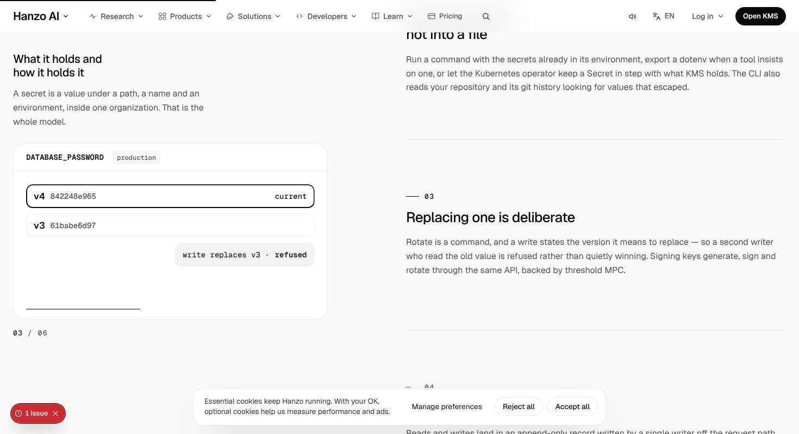
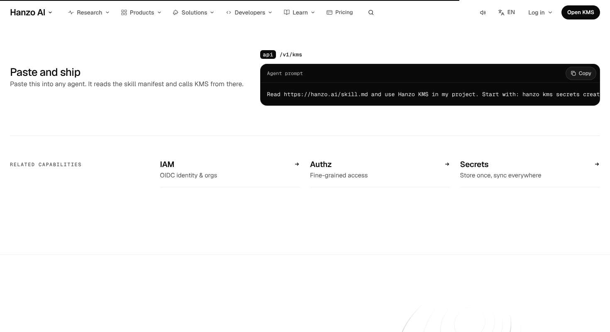
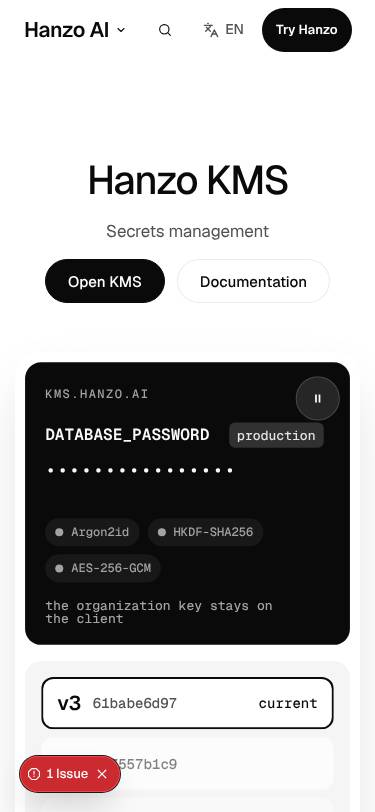

# /kms — James-eye review

Verdict: 7/10
First complaint: "The top half is alive: the vault seals and rotates, and the rules pin and redraw. Then it stops being KMS. A deployments list, a prompt box, three links and a '3 stars' badge, all on white, all quiet, the same tail as every other cloud page. Finish it as strongly as it starts."

Walked 2026-11-07 on the dev server at 1470x801 and 375x812 (recorder walk: 13 desktop and 18 phone scroll stops with idle pairs, 14 hovers, 3 clicks, video; my own probe: hover and press on the asks, vault tilt, typing into "Seal one yourself", frame bursts on the dark room, a 45-stop tab crawl, reduced motion, JS off, 320px width, 375x667 fold, phone hit-target sizes, heading sizes, section map, copy parity and taste.py). Ignored: the shared FooterHTML hydration error (the only console error, and the cause of the "1 Issue" badge) and the shared cookie card that covers the bottom 69px on desktop and 203px on phone.

## What works
- **The hero object is a real, self-running vault.** DATABASE_PASSWORD starts as dots, turns into the ciphertext of v3 by 3 s, rotates to v4 (the version stack slides by transform, the log gains "rotate · v4"), then refuses a stale writer. It settles in from scale within the first second, has a pause button, and tilts about 1.8° to the pointer (measured matrix3d, fine pointer only). Idle, time, state and pointer motion all in the first screen.
- **"Seal one yourself" really works.** Typing "hello" gave new ciphertext and IV at once (WebCrypto AES-256-GCM). The 56px field has a label, 22px text and a 2px focus ring. It's a proper Beyond aid.
- **The pinned "What it holds" stage is the best part of the page.** Six rules scroll past one pinned panel that redraws for each rule: the seal chain, `kms run`, the refused write, the agent's read, the language chips, and "daemon · will not boot". A clip-wipe and a hairline progress bar mark each change, with a `03 / 06` caption. This is the Apple pinned scene done properly.
- **The dark room arrives as a card, and its headline is cut in by line mask** ("Every read" first, then "recorded" rises in, caught mid-mask in my frame burst). It has one big figure and three small rows (AES-256, K8s, MIT). That's real scale rhythm.
- **Hygiene is clean.** CLS 0.0015 desktop and 0.0016 phone, no horizontal overflow at 375 or 320, parity 87/87 text and 12/12 links, taste.py OK, JS-off leaves no hidden heading or paragraph, and reduced motion lands on the final state (v4, ciphertext shown) with 0 running animations after 3.5 s.
- **The primary answers.** Hover goes from #0a0a0a to #262626, and press scales to 0.98. It has `data-cta="kms.hero"` and `data-thumb`. The header ask swaps to a solid "Open KMS" once the hero ask leaves view, and goes quiet again while the closing ask is on screen.

## The 11 answers
1. **Sells in 5 s, moves within 1 s?** Yes. h1 "Hanzo KMS" (52px/497) with the lede and ask, and the vault visibly settles within 1,000 ms (first-0ms vs first-1000ms differ). The secret decrypts and rotates by 3 s with no input. On phone the h1 is 40px at top 160, the primary bottom is at 303 of 667, and the vault starts at y≈362, so the product is above the fold.
2. **One in, one out, or a document?** It flows for the first 3,870px: hero, then seal, then the pinned rules, then the dark room. After that it turns into a document. Three quiet white sections follow back to back: `km-proj` (730px, a console on the left and one sentence on the right of a mostly empty screen), ShipPrompt (655px), and GetIt (903px). That is about 2,300px with no new idea about secrets, and it breaks the "no 3 quiet in a row" rule (part 3).
3. **A real object in every section?** Hero vault ✔, seal box ✔, pinned panel ✔, dark room terminal and figures ✔, Example console ✔ (it is Hanzo's own example, but it shows a deployments list, "gateway / payments-api / checkout-web — Ready / Building", with nothing tying it to keys or secrets on this page), agent prompt ✔ (a weak object), and GetIt contour line art ✔. So every section has an object, but the last three are the shared cloud tail.
4. **One ask, nothing floating, scale rhythm?** The header ask works on desktop (quiet at the hero, then solid "Open KMS"). On phone the header keeps a solid "Try Hanzo" next to the solid hero "Open KMS", so there are two solid fills in the first viewport. That's shared chrome, noted but not scored. Nothing of the page's own floats over content. Scale: the h1 is 52, "Every read recorded" is the one big figure, and the rest sits at 21 to 32. One inversion: the pinned section's own h2, "What it holds and how it holds it", is **21px**, while the six h3s beside it are **26px**. The chapter title is smaller than its children.
5. **Every hover and press answers?** Mostly. Primary: tone plus scale 0.98. Documentation: a faint shadow only (rgba(128,128,128,.1)), which is barely a change. Rule rows hover-fill. The related links have an arrow. The walker found 1 of 14 dead hovers on desktop (the console's "KMS" side item, which is the current item). The Copy buttons respond. No layout jumps (CLS 0.0015).
6. **Overlap, font swap, layout shift?** No font swap and no shift. **Phone hero crowding:** the pause button (296–340 × 377–421) sits 2px above the "production" tag (229–324 × 423–448) and overlaps it horizontally by 28px. In the 0 ms phone frame, before the vault settles, they touch. On phone the "write replaces v3 · refused" chip also sits over the bottom edge of the version list. On desktop the agent-prompt line and, on phone, the terminal lines run off the right edge with no fade to show they scroll.
7. **Which reference, and is its motion there?** apple.com product page: one pinned scene where one panel changes, with the product as the hero. That motion is really there in the pinned stage. The calm of chatgpt.com/business/enterprise shows in the dark room's quiet proof rows. Nothing of synchronized.studio, which is fine for this page type.
8. **Different from its neighbours?** The first half is clearly its own: a secret being sealed and rotated, plus a WebCrypto toy. The second half (the Console from `Frame`, `ShipPrompt`, `GetIt` with a Sigil seed) is the same three-part tail the other cloud product pages use, so /kms and /iam or /authz end identically.
9. **All 18 parts?** Strong on 1, 3, 4, 7, 8, 9, 11 and 12 (a ring on every one of 45 tab stops, no invisible stops, and a pause control). Gaps: part 3 (three quiet sections in a row at the end), part 6 (headline hierarchy inverted in the pinned section, and new prose not from the register), part 11 (on phone, "Open in the console" is 36px tall, "Deploy to Cloud" is 21px, and the console side links are 39px wide, all under 44px), and part 7 (inconsistent edges: the hero stage sits in an inset container at 125–1345 while every later section runs gutter to gutter at 24–1446, so the seal card nearly touches the right edge).
10. **Banned tells?** None hard. No hue (taste.py OK), no gradient text, no kicker above an h1 or h2 (the captions sit under their headings). Borderline: "Related capabilities" is IAM, Authz and Secrets as three equal columns in a row. They are hairline rows, not boxes, but they read as the "three equal" pattern.
11. **Copy untouched?** Parity passes (87/87, 12/12). But the "Seal one yourself" block adds about 60 words of new prose ("Your browser seals what you type with AES-256-GCM … browsers do not offer Argon2id, so here the key is random.", "SEALED BEFORE IT LEAVES YOU", "value", "ciphertext", "iv"). None of it is in `content/live/kms.json` or `content/ui-strings.json`. MASTER allows the Beyond aid, but new UI strings must come from the register.

## Fixes (in order)
1. **Give the tail a KMS moment, or shrink it.** `components/pages/cloud/Kms.jsx` lines 347–364. Keep the words, but stop three quiet white sections in a row. For example, merge `km-proj` and `ShipPrompt` into one two-part screen (the console on the left, the agent prompt on the right, the related links as a hairline row under both), and cut `km-proj` from 730px to its content height. Make the console answer the page's idea: on fine pointers, the existing row hover could show that service's DATABASE_PASSWORD version from the vault (`v4 · 842248e965`), so the example project and the secret are visibly the same story. That's the same data, so no new copy is needed. The page should end on one quiet `GetIt` after one louder screen, not after three flat ones.
2. **Register the Beyond copy.** Move every new string in the "Seal one yourself" block (heading, caption, paragraph, field labels) into `content/ui-strings.json` and read it from there, or cut the paragraph down to strings already on the page (the chain names and "the organization key stays on the client" already exist). Do not ship prose that is not in the register.
3. **Fix the pinned section's hierarchy.** `.km-holds-h` in `Kms.css` (line 87): set the h2 to the section size (26px), and drop the six rule h3s to 21px (`.km-rule h3`, or whatever class sets them to 26), so the chapter title outranks its rules.
4. **Clear the phone hero collision.** `Kms.css` line 175 (`@media` phone `.km-pause { top: 24px; right: 20px }`): move the pause button to the bottom-right of the black panel, or reserve its width on the name row (`padding-right: 56px` on the row with DATABASE_PASSWORD and the production tag), so it never sits within 2px of the tag. Also keep the "refused" chip inside the list box on phone instead of over its edge.
5. **One edge system.** Either put `km-seal`, `km-holds`, `km-proj` and `ShipPrompt` in the same 1152px container as the hero stage, or let the hero stage run to the same 24px gutters. Right now the right edge jumps from 1345 to 1446 between the hero and the seal card.
6. **Phone hit targets.** "Open in the console" (36px), "Deploy to Cloud" (21px) and the console side links (39px wide) need a 44px hit area. Pad them in the `Kms.css` overrides, or request it in `docs/requests/kms.md` if they live in `Frame`, `GetIt` or the shared kit.
7. **Show that code scrolls.** Add a right-edge fade mask on the agent prompt (desktop and phone) and on the terminal (phone), so clipped lines read as scrollable, not cut off.
8. **Documentation hover.** Give the secondary ask a hover that is more than a 10% grey shadow (a #f5f5f5 fill or a hairline darkening), with press at scale 0.98 like the primary.
9. **Shared, request only (`docs/requests/kms.md`):** the phone header keeps a solid "Try Hanzo" beside the solid hero "Open KMS" (two fills in one viewport) and never swaps to the page's ask.
