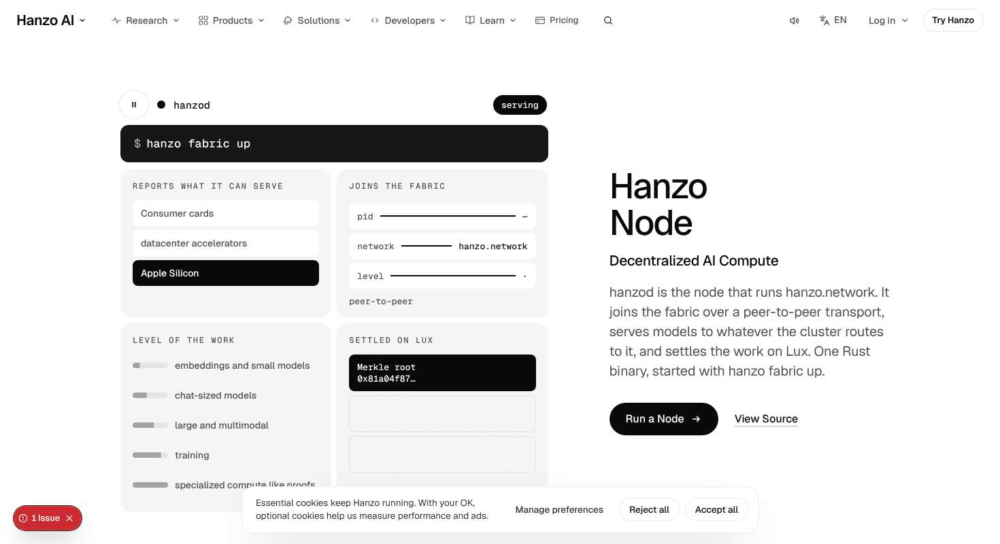
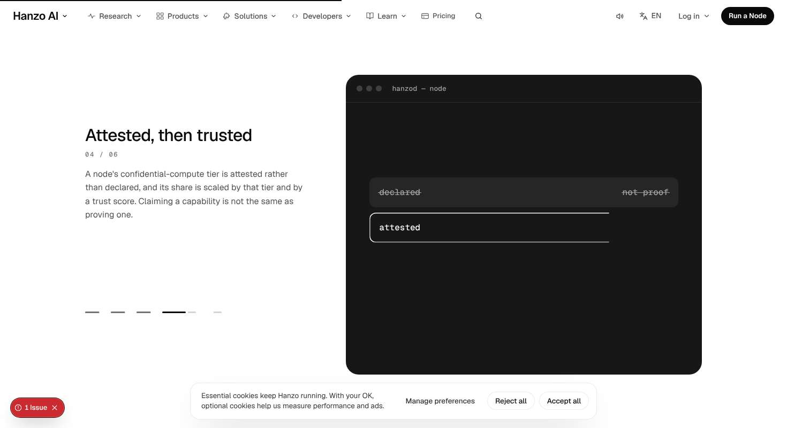
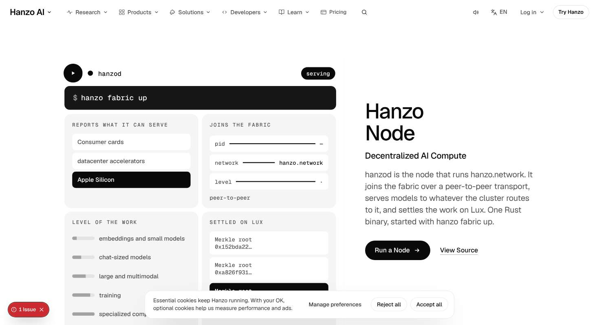

# /node — James-eye review

Verdict: 7/10
First complaint: "The first thing I see is a grey control panel: four boxes inside a box, twenty little labels and five black chips all blinking for attention next to the title. Then I scroll and get the same black terminal for four screens, mostly empty. It's alive, but it isn't premium yet."

Walked 7 Nov 2026 on the dev server at 1470x801 and 375x812 (recorder pass at both sizes, every scroll stop a/b; 100 ms frame sampling of the arrival at both sizes; hover and press on every page control; the drive control and the 01–06 chapter dashes clicked; "See the levels" sheet opened and closed with Esc; reduced motion at both sizes; JS off; a 45-stop Tab crawl; /network and /registry opened as neighbours). Frames: `node/r2-hero-panel.jpg`, `node/r2-empty-terminal.jpg`, `node/r2-reduced-motion-hero.jpg`.

## What works

- **The page moves on its own, in many kinds.** The hero machine runs itself once (stopped → starting → joined → serving, jobs lighting levels, Merkle roots settling, about 9 s), then rests serving, with a 44px pause/play control. The caret blinks from frame 0. Every chapter of the pinned stage plays a 2.8 s scripted beat when it arrives (the command typed in, chips one by one, bars filling, "declared" struck then "attested" ringed, up/join/stop driven once, roots appended) and rests on a blinking prompt. Kinds present: idle, pointer (2.5° tilt, a level you point at takes a job), time (typing beats), state (drive control, levels sheet, Copy confirm), arrival (h1 line-mask cut-in, odometer figures), scroll (stage settle, pinned chapters). Scroll is well under half.
- **Every tap answers.** Measured: Run a Node fill #0a0a0a → #262626 and press scale .97; View Source / About the Network underline parts 3px; See the levels fill + the plus turns 90°; Node docs arrow nudges 6px; Copy gets a ring; drive verbs fill #ededed on hover, scale .97 on press, ink when chosen, and the terminal rewrites to `hanzo fabric up/join/stop`. The 01–06 dashes are real 44px buttons that scroll to their chapter (the recorder's "not clickable" is wrong; verified). Recorder's "dead hovers" on up/join/stop are also wrong: they were off-screen in the pinned stack when sampled.
- **Clean engineering.** `parity.py /node`: OK, text 37/37, links 4/4. `taste.py` on Node.jsx/Node.css: OK. CLS 0.006 desktop, 0.003 phone. No horizontal overflow at either size. No page console error (the only one is the known FooterHTML hydration mismatch). Reduced motion: `getAnimations()` is empty after 3 s at both sizes, the chapters show their final frames. Tab crawl: skip link first, every main stop visible with the 2px ink ring and white halo; the sheet closes on Esc.
- **Scale at rest follows the deck.** h1 52px/497 (40px on phone), section heads 26px, figures 64px/220 (44px phone), lede 20px, chapter titles 32px. The header ask switches to "Run a Node" once the hero ask leaves (desktop).

## The 11 answers

1. **Sells in 5 s, moves in 1 s?** Moves: yes, the caret blinks at 0 ms and the machine goes "joined" by ~2.5 s. Sells: only half. The h1 is invisible until the cut-in starts: measured at 1.1 s on desktop and 1.4–1.8 s on phone after navigation (spans held at translateY 56.8px / 43.7px until then), so on the phone the first screen is a 90px hole above "Decentralized AI Compute" for over a second. And what you see first is the machine panel, not the product promise: four grey cells, ~20 labels (REPORTS WHAT IT CAN SERVE, JOINS THE FABRIC, LEVEL OF THE WORK, SETTLED ON LUX, three hardware rows, pid/network/level rows, five levels, three root slots) and five ink blocks (play, serving pill, Apple Silicon, level 02/05, newest root) competing with the one solid ask. It reads as an admin dashboard, not one object on a quiet stage.
2. **One in, one out, or a document?** Mostly one in, one out. Hero → figures → pinned chapters (3,108px, one chapter per ~48svh) → grey paste room (clip wipe) → close. But the pinned run is ~4 screens of the same graphite terminal with the same left column, so it becomes one long scene rather than a sequence; and after the figures row there are ~290px of empty white before the terminal arrives (screen 1, content ends at y 515 of 801).
3. **A real visual object in every section?** Yes, but the objects are thin. The pinned terminal is 665×560 and each chapter fills its top third: chapter 04 is two rows in a black box, chapter 06 three rows (see `r2-empty-terminal.jpg`). The paste room's object is a third black terminal. The close is the shared contour card. Three graphite/black terminal boxes in a row of sections (hero `$ hanzo fabric up` bar, pinned terminal, agent prompt) is one motif repeated.
4. **One ask in the header, nothing floating; scale rhythm?** One solid ask: yes; header carries "Run a Node" once the hero ask is gone (desktop), outlined while the page's own ask is in view. Nothing page-owned floats. Rhythm: the hero has none — the 52px title faces a panel of 20+ equal-weight 13–15px items. The figures row is four 64px numbers in four equal hairline cells: four big things at once, no medium among them.
5. **Every hover and press answers, no jumps?** Yes, measured above. Press scale shaves 3–5px of width visually (transform, no layout move). One nit: the hero ask's hover is only a fill shift #0a0a0a → #262626, the quietest change on the page for the most important button.
6. **Overlaps, font swap, layout shift?** CLS fine. But the hero object visibly resizes at hydration: at 0 ms the machine is drawn at its 1.06 start scale (top 140, 158–825px), at 1 s it has settled to 116/177–806 — a pop, not a scroll-linked settle. Under reduced motion it never settles: the machine stays at 1.06 and its last row and the levels list are cut by the 801 fold (`r2-reduced-motion-hero.jpg`). JS off shows the machine's first frame ("stopped", empty rows) rather than its final serving state. No overlaps at either size from the page; the shared cookie card (203px tall on phone) sits over the chapter-5 drive control and the bottom of each phone terminal until dismissed.
7. **Which reference, is its motion there?** Apple product page (pinned stage where one panel changes, product as hero) plus motion.dev micro-states. The pinned change is there and works. What is missing is Apple's one-idea-per-screen scale: the pinned panel never grows to be "the moment", its content sits small in a big dark box.
8. **Different from neighbours?** Hero medium differs from /network (graph) — a running machine. But the skeleton is the shared cloud template seen on /network, /registry and ~8 more: same PinnedChapters with six grey dashes bottom-left, text left / boxed object right, same ClipWipe grey paste room, same LaunchClose contour card. Below the hero, /node and /network are the same page with different words.
9. **18 parts covered?** Mostly. Header comment with Persona/Goal/CTA/Metric/Signature/Beyond and a V2 line: yes. One h1, `data-cta` node.hero / node.close, `data-thumb`: yes. Skip link, `<main>`, focus ring, Esc on the sheet: yes. Parity, taste: pass. Reduced motion final state: chapters yes, hero stage no (see 6). JS off: legible, but not the final frame. No proof strip before the closing Band (part 3) — n/a only if Hanzo's copy has none; not noted on the page. Sound: header toggle present; not verified per event.
10. **Banned tells?** No hue, no gradient text, no kicker above h1/h2, no Inter, no cursor glow. Closest to the list: "plain boxes / lazy look" in the hero's grid of four identical grey cells, and "everything big at once" in the four-figure row.
11. **Copy untouched?** Hanzo's body copy is intact (parity 37/37). But the terminals add new strings that are not in Hanzo's copy or `content/ui-strings.json`: "not proof", "✓ tier", "trust score" bar, "this CLI", "shares the name", "running · untouched", "running · active network", "names who would answer", "everything served across the peers", "where a model nobody serves loads" (Hanzo says "should be loaded"), "anchored · cannot quietly be rewritten", "waiting for work", and invented Merkle hashes. Paraphrased fragments in a demo are a copy change; list them as a copy question or take them from Hanzo's words verbatim.

## Fixes (in order)

1. **Calm the hero object into one thing** (`components/pages/cloud/Node.jsx` `Machine`, `Node.css` `.nd-mac*`): drop the four-cell dashboard for a single surface where one state is large at a time — e.g. the status line and the command at size, then *one* changing readout (the level being served, or the newest root) as the big element, with hardware/process/roots as one quiet line each. Cut the simultaneous ink blocks to one (the serving state), so the only solid fill competing with "Run a Node" is gone. Target: under 8 visible labels in the hero, one big / few medium / rest small.
2. **Make the pinned terminal earn its size** (`Screen` and `.nd-term*`): either shrink the terminal to its content (≈ 300–360px) or let each chapter's one key thing grow to be the moment (the "a tenth" bar ladder, the attested ring, the Merkle chain) and settle back. No chapter should leave 60% of a 560px black box empty. Close the ~290px gap between the figures and the pinned stage (`.nd-why` bottom padding).
3. **Show the title from the first paint** (`Title`, `Node.css` lines 9–13): start the cut-in on the first frame after load (or at most 300 ms), not after hydration; the 1.6 s CSS failsafe is too late for the phone, where the first screen has a hole for 1.4–1.8 s.
4. **Fix the stage settle** (`SettleStage from={1.06}` in `Node()`; request the reduced-motion/initial-state fix in `components/v2/SettleStage.jsx` via `docs/requests/node.md`): render the server/initial and reduced-motion state at scale 1 so nothing pops at hydration and the machine fits the 801 fold with motion off. Render the machine's final serving frame in server HTML / JS off.
5. **Break the four-equal-figures row** (`SpecDrawer` rows): give one figure the stage (1/10 of the block reward is the story) and set the other three medium, or reveal them one at a time as the row is reached.
6. **Copy questions** (card + Node.jsx `Screen`, `DRIVE`, `Machine`): replace terminal strings with Hanzo's own words verbatim ("where a model nobody serves should be loaded", etc.) or list each added string as a copy question for James; label the drawn hashes as illustrative or drop them.
7. **Differ from /network below the hero:** the six-dash pinned layout, ClipWipe room and contour close are the same on ~10 cloud pages. Give /node one structural move of its own (e.g. the hero machine itself pins and becomes the chapter stage, so the object you met is the one that changes) instead of a second, unrelated terminal.
8. **Hero ask hover:** add a second change beyond the #262626 fill (the arrow nudge the Node docs link already has), so the primary answers at least as visibly as the text links.
9. Shared chrome, not scored: on phone the header ask stays "Try Hanzo" past the hero (desktop swaps to "Run a Node"); a grey smear shows in the desktop header glass over Learn/Pricing on the light grey room; cookie card covers the phone drive control.
