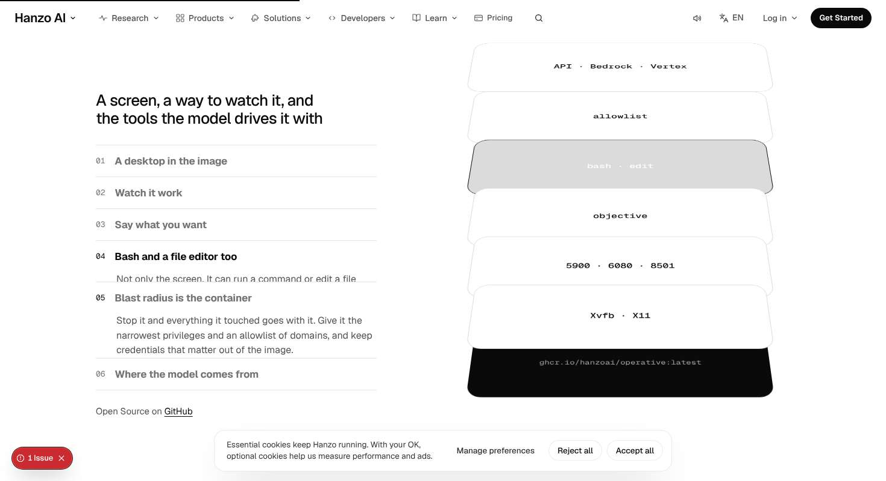
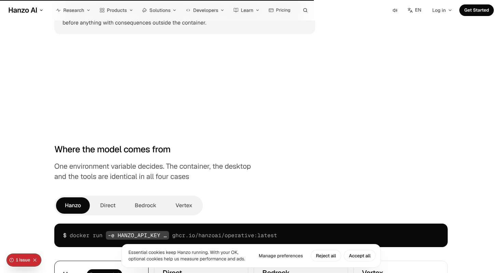
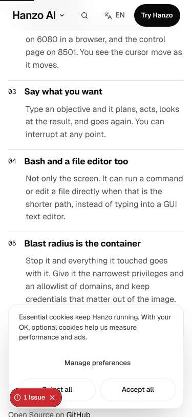

# /operative — James-eye review

Verdict: 6/10
First complaint: "The container comes apart in the first half-screen, then I scroll through three more screens of the same blank white cards while the list on the left jumps about. After that it's a document again: four equal boxes full of bullets and big empty white gaps."

Walked 7 Nov 2026 on the dev server at 1470x801 and 375x812. I scrolled the whole page at both sizes and compared every screen stop 1.2 s apart for idle motion. I checked first paint at 0, 1000 and 3000 ms and hovered and pressed every page control. I clicked the hand tabs, chapters, Replay, provider segment and cards. I logged layout shifts with their sources, took frames of the pinned stage every 150 px, and checked reduced motion (`getAnimations()`), JS off and a 30-stop Tab crawl. I also ran `parity.py` and `taste.py`. Frames are in `docs/review/operative/`.

## What works
- **It moves without input.** The hero desktop is worked by its four hands. The cursor glides, the "Multimodal Models" chip and the key caps arrive in turn, and the 01–04 rail tracks it with a time bar. The first change lands inside 1 s at both sizes (`first-1000ms` vs `first-3000ms`).
- **There is a good mix of motion types.** Idle: the hero demo and the loop in the dark room. Time: the two `docker` commands type themselves, then the four ports light one by one. Scroll: the stack explodes. State: the provider pill glides (`layoutId`) and the env fragment rolls in the command line. Arrival: the h1 cuts in. Scroll-linked work is well under half of the motion.
- **Scale is on the deck.** h1 is 52px/497, section heads 26px, port figures 44px/220 and the lede 21px. The loop grows only while it is the moment (`A2Grow`).
- **The copy is intact.** `parity.py /operative` gives text 104/104 and links 6/6. Kickers are kept as screen-reader-only text, so nothing sits above a headline visually.
- **Reduced motion and JS off are clean.** With reduced motion, `getAnimations()` returns 0 after 3.5 s, the run command shows in full and all 4 ports are lit. With JS off, the h1 and stage are visible at opacity 1.
- **The dark room** (`See Operative in Action`) is the best screen on the page. Huge loop words step through with a real pause control and one image with a cursor, quiet and alive.

## The 11 answers
1. **Does it sell in 5 s and move within 1 s?** Yes, it moves. The hero desktop is running by 1000 ms. The sell is weaker. At 0 ms the lede and buttons paint before the h1 (`first-0ms.jpg` shows no title). The h1 then sits *below* the lede: h1 top 235, lede top 164, CTA bottom 331. The eye reads the explanation before the name, which breaks the 8/5 rule of "heading left, lead right, aligned to the bottom". At 375 the h1, lede, primary and 183px of product fit inside 660px. That passes.
2. **One thing in, one thing out, or a document?** Half and half. The pinned "What is in the container" scene is 460svh (3,685px at desktop). The stack fully explodes within the first ~150px (`probe/d-inside-0..1`). The other ~3,400px change only which slab is inverted and which paragraph is open. That is about four screens of the same picture (`screen-02` to `screen-06` are nearly identical; idle diff on `screen-03`/`04`/`06` is 0 bytes). After it, `One docker run` → requirements/usage → warning → providers reads like a docs page. It has 300–340px dead white bands between blocks (`d-dead-gap.jpg`: warning bottom y=100, next heading y=437). On phone the six chapters are all open at once, a wall of prose about 900px tall (`p-wall-of-text.jpg`).
3. **Does every section hold a real object?** Mostly. Hero: a live desktop. Inside: the slab stack, but it is blank white cards with a mono word each, abstract rather than the product. Run: a terminal plus a port panel. Ways: a command line plus 4 cards. Action: an image with a cursor. Watch: a grey card with a `docker pull` line, so that section has a text list and a grey box but no object. Only one real image is used on the whole page (`/models/iro.webp`, twice), and it is labelled "Demo Video" although it is a still.
4. **One ask in the header, nothing floating, and does scale have rhythm?** Partly. The hero primary `Get Started` carries `data-cta="operative.hero"` and `data-thumb`. The header ask reads "Try Hanzo" (outlined) at the top and turns into a solid "Get Started" after the hero, which is shared chrome. The closing `Band` brings a *second, different* solid ask, "Deploy to Cloud", so the page ends on an ask the hero never made. Hanzo's words, so it stays, but it splits the conversion. Rhythm is good: one big thing per screen, with 26px heads against 44px port figures. Nothing page-owned floats. The cookie card covers about 200px at 375 for the whole walk, but that is shared chrome.
5. **Does every hover and press answer, without jumps?** No. Every control presses (scale .98/.97), but the walk shows 11 of 14 hovers dead on desktop. Measured: the four hand tabs, the six chapter buttons, the provider cards and "View more examples" change nothing on hover. Only the underline on "View more examples" moves, and the social rows only nudge their arrow. The primary's hover is a fill change to `rgb(44,44,46)` that tells nothing. No hover anywhere shows a number or a preview. Clicks do work when tested directly: a hand tab sets `aria-pressed` and moves the desktop, a chapter scrolls to its step, Replay restarts typing, and the provider segment swaps the env. The walker's "dead click" count is inflated by the auto-advance.
6. **Any overlap, font swap or layout shift?** Yes:
   - **Layout shift:** desktop CLS is **0.074**, against a 0.02 budget. The source is the chapter accordion. `.xov-list p` transitions `grid-template-rows` and `padding` (Operative.css:74), so each `li` collapses from 127px to 53px and the rows below jump 74px. The shifts I logged come from those `LI`s.
   - **Overlap:** in every exploded state the bottom slab ("Xvfb · X11") sits on the base label, so `ghcr.io/hanzoai/operative:latest` shows as clipped glyphs (`d-inside-collapse.jpg`). Mid-scroll, chapter 04's paragraph is cut by 05 rising into it (the same frame shows "Not only the screen. It can run a command or edit a file" sliced through).
   - **Phone:** the docker commands break mid-word (`operative:lates` / `t`, `operative:l…`) because of `overflow-wrap: anywhere`.
   - No horizontal overflow at either size. Phone CLS is 0.00.
7. **Which reference does it feel like, and is its motion there?** It wants apple.com, with a pinned scene where one panel changes, and partly gets there. The pin and the scrub are real. Apple's rule is that *each* scrubbed step visibly transforms the object, though, and here after the explode only one slab's fill flips. The dark loop has a little of the anthropic.com launch feel. synchronized.studio and osply/hamol pointer detail are absent. There is no tilt, magnetism or cursor-aware light on the hero desktop, which begs for it.
8. **Is it different from its neighbours?** Yes in idea: a container exploding into layers, and a desktop worked by four hands. Its neighbour /operator uses a drifting cluster board, so the signatures differ. The frame is the shared A2 template: h1 left, lede and acts right, stage below, a pause plus numbered pill rail. That frame is shared with Sdks, Studio, Mcp, Ide, Operator, Tag, Skills and Slack, so the *first screen* layout is not distinctive. One more housekeeping mismatch: `app/operative/page.jsx` line 1 still describes a different signature ("doors swing back"), while the component says "explode upward".
9. **Are all 18 parts covered?** Judged from the page, not the card. Missing or failing: part 2 (`<main>` has no `id="main"`); part 3 (one in, one out, plus dead gaps); part 4 (two different solid asks: hero and Band); part 6 (four equal cards with explaining bullets, a phone wall of text); part 7 (literal Apple greys `#f5f5f7`, `#d2d2d7`, `#e5e5ea`, 7 occurrences in Operative.css, which are not deck values; the deck has `#f5f5f5`, `#d4d4d4`, `#e5e5e5`); part 8 (hover states missing; height, padding and max-width animated at lines 26, 74 and 247); part 12 (the hero pause glyph renders as a ~4px smudge at 1470, see `probe/pause-hero.png`, so it does not read as pause). Present: header comment, one h1, JSON-LD, canonical, `data-cta` and `data-thumb`, reduced motion, JS off, copy-equals-display on the install block, pause controls on both loops, and a Tab crawl with a 2px ring and no invisible stops.
10. **Any banned tells?**
    - **Clutter:** four equal boxes in a row, each with three explaining bullets, a "Set …" line and a command (`xov-cards`). They also repeat the selection the segment control right above already makes.
    - **Blur reveal:** the closing `Band` headline reveals word by word with `filter: blur(12px)` (measured), which MASTER bans ("No opacity-and-blur reveal"). That lives in the kit `Band`, so it needs a shared request, but it shows on this page.
    - **Inconsistent spacing:** 160px under the hands rail, 340px above "Where the model comes from", 230px above "One docker run".
    - **Plain look:** the port list uses disc dots before 44px figures, and port `8080` has no label beside it, so it reads like an unfinished list.
    - No hue (`taste.py` OK), no gradient text, no Inter, nothing above a headline.
11. **Is the copy untouched?** Yes. Parity is 104/104 text and 6/6 links. "by The default", "Recommended" and "router interfaces" all appear in `content/live/operative.json` as written.

## Fixes (in order)
1. **Make the pinned scene earn its 460svh** (`Operative.jsx` `Inside`, `Operative.css:62,79-85`). Either cut it to about 220svh, or tie the explode to the whole scroll so each of the six steps visibly moves something. For example, the active slab lifts out and opens to show what it is: the ports, the objective field, a bash prompt. Don't spread the explode over the first 14% and then only flip a fill. Fix the base label overlap by giving `.xov-base` its own gap below the last slab, or by putting the label on the slab's front edge.
2. **Kill the accordion layout shift.** Stop animating `grid-template-rows` and `padding` on `.xov-list p` (line 74). Keep all six rows at a fixed height and reveal the active paragraph in a single fixed-height slot under the list, with clip-path or transform only. Target CLS under 0.02 (it is 0.074 now). Apply the same rule to `.xov-typed` (`max-width`/`width` transitions at lines 26 and 247).
3. **Cut the clutter in "Where the model comes from".** Use the segment control *or* the cards, not both. Keep the segment and the rolling command line, and show only the chosen provider's three points and `Set …` line in one panel that changes on selection, not four equal boxes. Same words, one object.
4. **Close the dead gaps and give each block one idea per screen.** Remove the ~300px voids (the sticky tail after the Inside section, and the space above `xov-ways`). Fold System Requirements and Basic Usage into a disclosure under the terminal so `One docker run` is one screen: terminal plus ports. Give `Watch`/`Get Operative` a real object, or merge it into the Band.
5. **Make every hover answer** (`Operative.css`). Hand tabs: on hover, preview that hand on the desktop (move the cursor ghost or show the chip). Chapter buttons: ink colour plus the matching slab lifting 12px. Provider cards: the env fragment in the command line previews. Port rows: light the port on hover. Keep everything inside `@media (hover:hover)` and transform-only.
6. **Phone composition** (`@media (max-width: 899px)`, lines 207-220). Don't open all six chapters at once (line 220 forces `height:auto`). Show one at a time, stepped by the hands rail or by tapping. Stop mid-token wrapping on commands: use a horizontal scroll region (`tabindex="0"`), not `overflow-wrap:anywhere`.
7. **Use deck values only.** Replace `#f5f5f7`, `#d2d2d7` and `#e5e5ea` (7 occurrences) with deck tokens (`#f5f5f5`, `#d4d4d4`, `#e5e5e5` via `var(--…)`). Fix the hero `.xov-pause` glyph size so it reads as pause at 44px.
8. **Hero order.** Bottom-align the two columns of `.xov-top` so the h1 baseline and the CTA row share a line, or put the lede under the h1. Either way, the name should read before the explanation and paint no later than it. Add a ≤2.5° pointer tilt or a cursor-aware light to the hero desktop on fine pointers. It is the obvious pointer moment and the page has none.
9. **Request a shared fix and tidy up.** File `docs/requests/operative.md` asking for a `Band` headline reveal without blur (line mask instead), and a `Cta` hover from the deck ramp (`#262626`, not `#2c2c2e`). Add `id="main"` to `<main>`. Bring `app/operative/page.jsx`'s Signature comment in line with the component.

